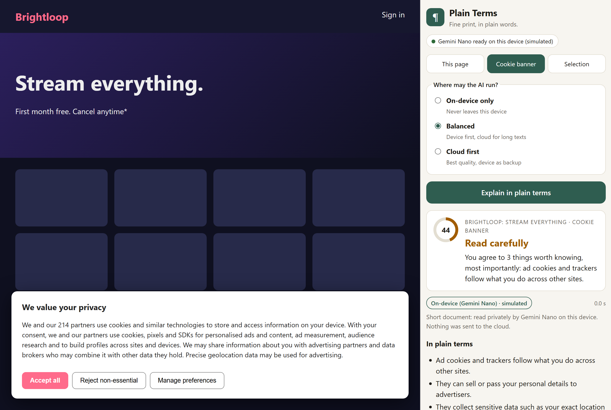
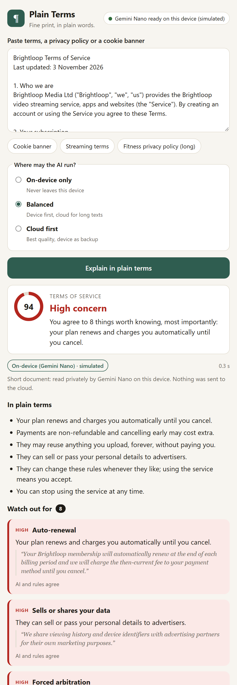
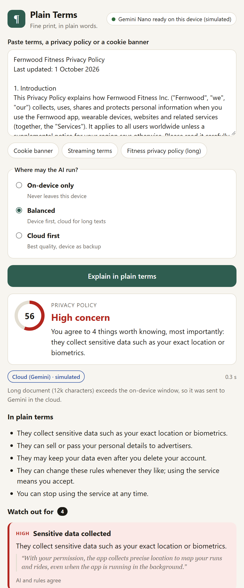
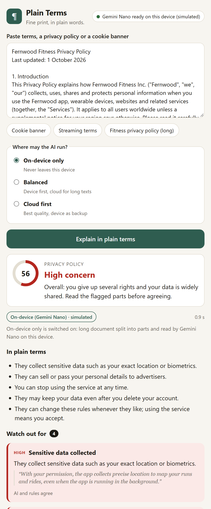
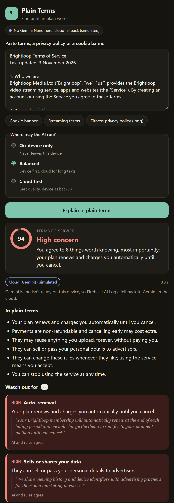

# Plain Terms

**Fine print, in plain words.** Plain Terms is a Chrome extension and web app that rewrites terms of service, privacy policies and cookie banners into plain language and flags the clauses that can hurt you: data sale, auto-renewal, forced arbitration, broad content licences and more.

It runs the AI **on your device with Gemini Nano** when it can, and falls back to **Gemini in the cloud** through **Firebase AI Logic hybrid inference** when the document is too long for the on-device model or the device has no Nano. A deterministic rule engine runs alongside both, so you always get an answer, even offline with no model at all.



## Why

Almost nobody reads the fine print. It is long and written to be skimmed past, and the parts that matter (you're selling your data, you'll be billed until you cancel, you can't sue) are buried. Legal text is also often private context: the page you are on, the service you are about to sign up for. That makes this a natural fit for on-device AI. Short texts never need to leave your machine, and the cloud is only used when it really helps and you allow it.

## Features

- **Three sources in the extension side panel:** the whole page, the visible cookie banner (found automatically), or the current selection. You can also right-click selected text and choose **Explain "…" in plain terms**.
- **A plain-language result:** a one-line TL;DR, up to six plain bullet points, a concern score from 0 to 100, and risk cards that quote the exact clause.
- **Grounded quotes:** every clause the AI flags is checked against the source text. Findings whose quote isn't in the document are dropped and counted in the notes.
- **Transparent routing:** each result shows where it ran (on-device, cloud, rules) and why, in one sentence.
- **Privacy control:** choose *On-device only*, *Balanced* (the default) or *Cloud first*.
- **Never a dead end:** if the cloud fails, the app switches to on-device chunks. If that fails too, it falls back to rules-only, and the UI says so.
- **Demo mode:** with no Firebase config, the app runs the rule engine only and is clearly labelled.

## How hybrid inference is chosen

The routing policy lives in [`src/core/router.js`](src/core/router.js), which is pure and unit-tested. It decides from facts it can observe: document length, whether the browser is online, `LanguageModel.availability()` and the user's privacy setting.

| Situation | Firebase AI Logic mode | Strategy |
|---|---|---|
| Short text (≤ `on_device_max_chars`, default 12k chars), Balanced | `PREFER_ON_DEVICE` | Gemini Nano reads it in one call. The SDK falls back to the cloud if Nano isn't available. |
| Long text, Balanced or Cloud first | `ONLY_IN_CLOUD` | One cloud call over the whole document. If that fails, Nano reads it in ~9k-char chunks (`ONLY_ON_DEVICE`) and a short reduce prompt merges the parts. |
| Any length, Cloud first | `PREFER_IN_CLOUD` | Cloud quality first. The SDK falls back to Nano on network errors. |
| *On-device only* selected, or offline | `ONLY_ON_DEVICE` | A single call, or map-reduce over chunks for long texts. Nothing is sent to the cloud. If Nano is missing, rules only. |
| No Firebase config / demo mode | none | Rules only, labelled "Demo mode". |

After each call, the engine reads `response.inferenceSource` from Firebase AI Logic and **reports where inference actually ran**, not where we hoped it would. For example, the UI says "Gemini Nano isn't ready on this device, so Firebase AI Logic fell back to the cloud" when `PREFER_ON_DEVICE` ended up in the cloud.

The thresholds (`on_device_max_chars`, `chunk_chars`, `max_chunks`, `cloud_max_chars`) and the cloud model name are **Firebase Remote Config** parameters (see [`remoteconfig.template.json`](remoteconfig.template.json)), so the routing can be tuned without shipping a new extension.

The on-device and cloud paths share one JSON schema ([`src/core/prompts.js`](src/core/prompts.js)). It is passed as `responseConstraint` to the Prompt API and as `responseJsonSchema` to the cloud model, so both return the same structure.

## Architecture

```
extension/            MV3 manifest, side panel HTML, background service worker
web/                  hosted web app shell (Firebase Hosting)
src/
  entry-extension.js  side panel: page / cookie banner / selection sources
  entry-web.js        web app: paste box + samples (+ ?mock / ?demo switches)
  extract.js          functions injected into the tab (chrome.scripting)
  ui/app.js           shared UI, wires Firebase client into the engine
  firebase/client.js  Firebase App, App Check, AI Logic hybrid model, Remote Config
  core/
    router.js         hybrid routing policy (pure)
    engine.js         plan -> model calls -> fallbacks -> grounding -> merge
    detector.js       deterministic risky-clause rules + scoring
    merge.js          tolerant JSON parsing, quote grounding, merging
    segment.js        normalisation, sentence split, chunking
    prompts.js        prompt + shared JSON schema
    mock-model.js     simulated model for offline demos/screenshots/tests
samples/              original fictional documents (cookie banner, ToS, long policy)
test/                 node:test suites (30 tests)
scripts/              build (esbuild), screenshots + icons (headless Chrome)
```

Firebase products used:

- **Firebase AI Logic** (`firebase/ai`): `getGenerativeModel(ai, { mode, inCloudParams, onDeviceParams })`, `initializeDeviceModel()`, `generateContent()`, `inferenceSource`. Gemini Developer API backend (free tier).
- **Firebase App Check** (required by AI Logic): reCAPTCHA v3 on the hosted web app, and the debug provider in the extension. MV3 forbids remote scripts, so reCAPTCHA can't load there. Each extension install generates its own debug token and shows it under *Settings and diagnostics* so it can be registered once. No token is committed.
- **Firebase Remote Config**: routing thresholds and the cloud model name.
- **Firebase Hosting**: the web app.

The extension asks for minimal permissions: `activeTab`, `scripting`, `sidePanel`, `storage` and `contextMenus`. There are no blanket host permissions. Per-site access is requested only if `activeTab` has expired.

## Setup

Requirements: Node 20+ and Chrome 139+ on desktop. On-device inference needs a machine that can run Gemini Nano (see Chrome's hardware requirements).

```bash
npm install
npm test            # 30 unit tests, no browser needed
npm run build       # -> dist/extension and dist/web (demo mode without config)
```

### Connect Firebase (free Spark plan)

1. In the [Firebase console](https://console.firebase.google.com), create a project. Google Analytics is not needed.
2. Go to **AI Services → AI Logic → Get started** and choose the **Gemini Developer API** (no billing). This also enforces App Check for AI Logic.
3. Open **Project settings → Your apps → Add app → Web** and copy the config object.
4. Copy `firebase.config.example.json` to `firebase.config.json` (it is git-ignored) and paste in the values.
5. *Hosted web app only:* create a reCAPTCHA v3 key for your `*.web.app` domain. Register it under **App Check → Apps → your web app → reCAPTCHA**, and put the site key in `recaptchaSiteKey`.
6. Run `npm run build`.

### Load the extension

1. Open `chrome://extensions`, turn on **Developer mode**, click **Load unpacked** and pick `dist/extension`.
2. Click the Plain Terms icon to open the side panel, then open **Settings and diagnostics** and copy the **App Check debug token**.
3. In the Firebase console, go to **App Check → Apps → your web app → ⋮ → Manage debug tokens** and add the token. Cloud fallback now works from the extension.

### Enable Gemini Nano (on-device)

Set `chrome://flags/#prompt-api-for-gemini-nano-multimodal-input` to **Enabled** and restart Chrome. The first click on **Explain in plain terms** calls `initializeDeviceModel()`, which starts the model download. Progress appears in the status pill. Until the download finishes, requests fall back to the cloud automatically.

### Deploy the web app (optional)

```bash
npx firebase-tools login
npx firebase-tools use --add          # pick your project
npx firebase-tools deploy --only hosting,remoteconfig
```

### Offline demo switches (web app)

| URL | Effect |
|---|---|
| `?demo=1` | rules only, no AI calls |
| `?mock=auto&nano=available` | runs the full hybrid pipeline with a **simulated** model. Results are labelled "simulated". Used for the screenshots in `docs/`. |
| `?sample=terms&run=1` | preloads a sample and runs it |
| `?privacy=private` | starts in On-device only mode |
| `?theme=dark` | forces dark theme |

## Screenshots

The images in `docs/` were rendered with headless Chrome (`npm run screenshots`) using the **simulated** model, and they say "simulated" on screen. Real on-device and cloud results look the same, minus that label.

| | |
|---|---|
|  |  |
|  |  |

## Limitations

- Plain Terms explains text; it is not legal advice.
- The prompts and rules are tuned for English.
- Gemini Nano is only available in desktop Chrome on supported hardware.
- Very long documents are capped (`cloud_max_chars`, `max_chunks`) to stay inside free-tier quotas. The rule engine still scans the full text.

## License

[Apache-2.0](LICENSE). The sample documents describe fictional companies.
